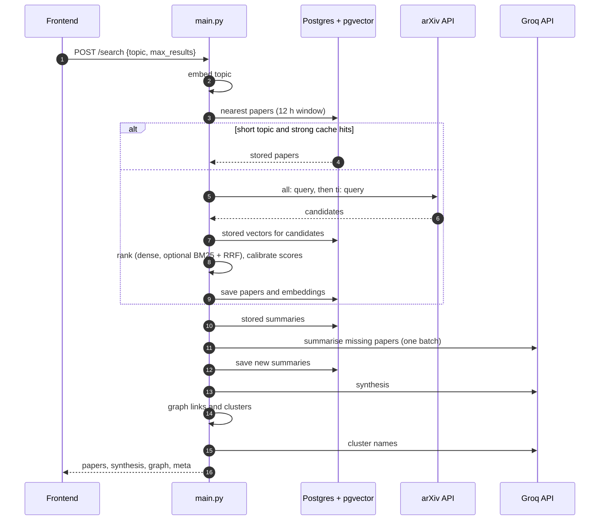
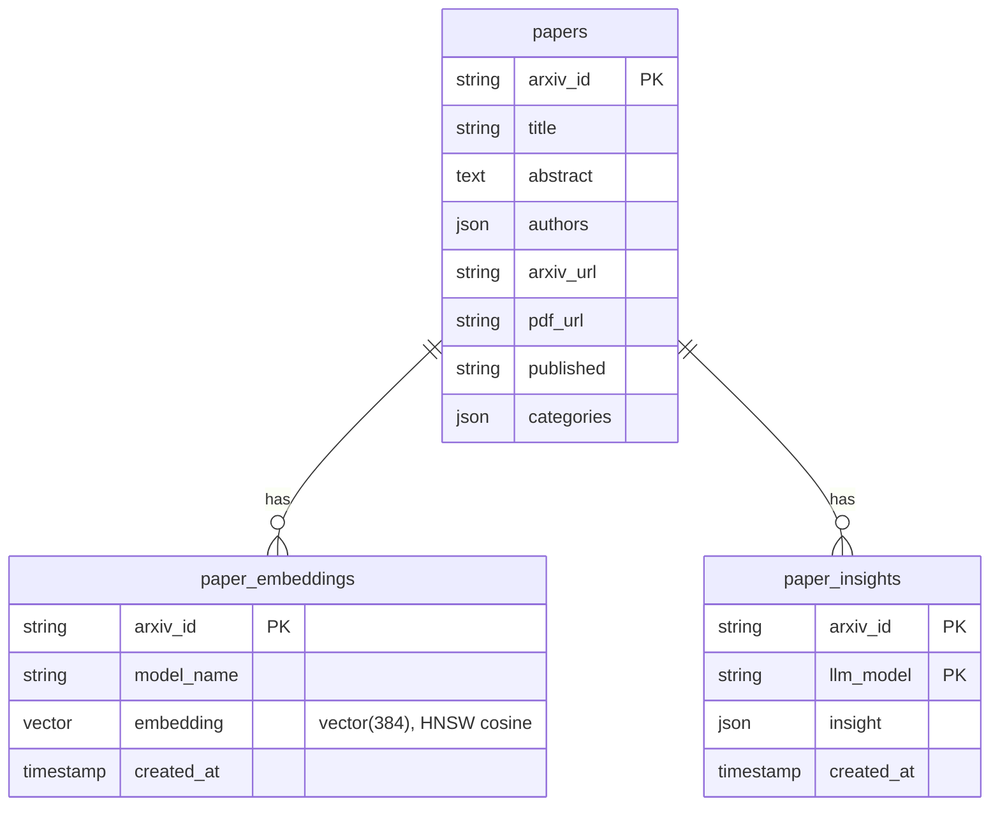

# Project Report — Kavosh (BTP Semester 7)

*Kavosh (کاوش) is Persian for "exploration". The project was called Research
Copilot until November 2026.*

## 1. Overview

Kavosh helps students and researchers get into a topic quickly. Given a topic,
it retrieves candidate papers from arXiv, ranks them by meaning with a sentence
embedding model, summarises each one with an LLM (TL;DR, problem, method,
benchmarks) and checks the summary against the abstract, writes a cross-paper
synthesis, and draws a 3D reading map of how the papers relate.

| Layer | Technology |
|---|---|
| Backend | FastAPI (Python 3.12) |
| Embeddings | sentence-transformers, `all-MiniLM-L6-v2` on CPU by default; swappable |
| LLM | Groq API, `openai/gpt-oss-20b` |
| Storage | PostgreSQL 16 + pgvector (HNSW cosine index), SQLAlchemy 2, Alembic |
| Frontend | Next.js 16 (pages router), React, Tailwind CSS v4, react-force-graph-3d / three.js |
| Evaluation | `eval/` harness (noise robustness benchmark, threshold calibration, t-SNE) |
| Deployment | Frontend on Vercel; backend on the developer's machine, shared through a Cloudflare quick tunnel; `docker-compose.yml` for a one-command backend |

The project is also the Semester 7 continuation of the Semester 6 study on word
embeddings under textual noise (Section 8 and `docs/SEM6_CONTINUITY.md`).

## 2. Architecture


The backend is organised as small modules (arXiv client, embedders, hybrid
retrieval, LLM service, grounding, telemetry, database layer) orchestrated by
the `search()` handler in `main.py`. All tunable values live in `config.py` and
are read from the environment.

## 3. Search pipeline

`POST /search` with `{topic, max_results}` (default 5) runs these steps:

1. **Embed the topic** with the active embedder.
2. **Cache-first lookup.** Query `paper_embeddings` by cosine similarity (HNSW)
   with a 12-hour freshness window. For short topics (≤ 2 words), if the best
   hit reaches `CACHE_TOP_SCORE` and at least `max_results` hits reach
   `CACHE_STRONG_SCORE`, the stored papers are used and arXiv is skipped.
3. **Otherwise fetch from arXiv** (`arxiv_client.search_papers`): up to 50
   candidates from an `all:` query plus up to 10 from a `ti:` title query,
   merged and tier-sorted (exact title first, then titles containing every
   significant query word). User text is escaped so it cannot change the query.
4. **Rank** by cosine similarity, reusing stored vectors and embedding only new
   abstracts. With `HYBRID_RETRIEVAL=1`, BM25 over title + abstract is fused
   with the dense ranking by Reciprocal Rank Fusion (`k = 60`).
5. **Calibrate scores** for display: `sigmoid(10 · (cosine − β))`, with β
   different for short and long queries, plus a `TITLE_BOOST` (+0.15) when the
   topic appears in the title; a near-exact title match is pinned to 1.0.
6. **Summaries.** Stored summaries are read first; missing ones come from one
   batched Groq call, parsed defensively (`_safe_json_loads` repairs LaTeX
   escapes and aligns items by index), then stored. On an LLM failure the
   placeholder summaries ("Error") are stored too; see Section 11.
7. **Grounding check** (`grounding.py`): the share of summary terms found in
   the abstract, and the terms that were not.
8. **Synthesis**: one Groq call combining the summaries.
9. **Reading map**: up to 30 papers. Link weight = 0.65 × abstract similarity
   + 0.25 × category overlap (Jaccard) + 0.10 × shared author; links above a
   threshold are kept. Node size blends link count and relevance. Clusters are
   connected components, named by one Groq call.
10. **Cache write-back** of papers, embeddings and summaries, and telemetry.



## 4. API

| Endpoint | Purpose |
|---|---|
| `POST /search` | Run the pipeline. Body: `topic` (1–500 chars, not blank), `max_results` (1–50, default 5). |
| `GET /health` | Status plus the active embedding model, LLM and hybrid setting. |
| `GET /metrics` | Uptime, counters, cache hit rates, and p50/p95/mean latency per pipeline stage and cache path. |
| `GET /docs` | Interactive API documentation generated by FastAPI. |

Response of `/search`:

| Field | Contents |
|---|---|
| `papers[]` | `title`, `abstract`, `authors`, `arxiv_id`, `arxiv_url`, `pdf_url`, `published`, `categories`, `relevance_score`, `summary` (`tldr`, `problem`, `methods`, `benchmarks`, `grounding`), `matched_terms` |
| `synthesis` | Cross-paper synthesis text |
| `graph.nodes[]` | `id`, `title`, `val`, `cluster`, `year`, `short_label` (e.g. "Ye 2024"), `primary_category`, `degree`, `author_surnames`, `arxiv_url`, `pdf_url` |
| `graph.links[]` | `source`, `target`, `weight` |
| `meta` | `cache_path` (`warm` / `cold`), `latency_seconds`, `embed_model`, `hybrid_retrieval` |

A topic with no arXiv matches returns 404, which the frontend shows as an empty
result rather than an error.

## 5. Data layer



- **papers:** one row per arXiv ID.
- **paper_embeddings:** a 384-dimensional vector per paper with an HNSW cosine
  index. The primary key is `arxiv_id` alone, so only one embedding model's
  vector is kept per paper; reads filter on `model_name` so vectors from
  different models are never mixed.
- **paper_insights:** LLM summaries keyed by `(arxiv_id, llm_model)`.
- Writes are upserts (`ON CONFLICT`); the schema is created by Alembic
  migration `0001_initial.py`.

## 6. Frontend

- **Start page** (`pages/index.tsx`): a live status bar from `/health`, a
  headline revealed word by word, a search field with example topics, a
  "what happens when you search" section whose lines darken as they scroll
  into view, and a wordmark footer.
- **Results:** three panes on wide screens (ranked list | reader | map),
  stacking below 1024 px. Ranked rows show rank, title with matched terms
  highlighted, author · year · category, and relevance as a segmented meter.
  The reader has a Synthesis tab (with the papers it draws from) and a Paper
  tab (TL;DR, problem, method, benchmarks, summary check, abstract, arXiv and
  PDF links).
- **Loading and errors:** the five pipeline steps as a checklist with a block
  progress bar; plain-language empty and error states.
- **Reading map** (`components/ReadingMap.tsx`): 3D force graph. Colour is
  publication year on a single-hue ramp; size is link count; ranked results
  carry a ring; selecting a paper highlights its neighbours and dims the rest.
  Hovering a node shows a card with arXiv page and PDF buttons; the details
  panel lists the most similar papers; clusters can be filtered. The layout is
  computed before the first frame, so the graph does not animate, and the
  camera is framed from the laid-out positions.
- **Design:** tokens in `styles/globals.css` (ice-blue / navy palette, light and
  dark themes, all text ≥ 4.5:1 contrast), Geist and Geist Mono via
  `next/font`, motion primitives in `components/Motion.tsx` that respect
  `prefers-reduced-motion`. The design rules are recorded in
  `docs/DESIGN.md`.
- **Backend address** (`lib/api.ts`): a `?api=` tunnel link (remembered per
  device), else `NEXT_PUBLIC_API_BASE`, else `http://localhost:8000`.

## 7. Configuration

Environment variables (see `.env.example`; defaults in `backend/app/config.py`):

| Variable | Default | Purpose |
|---|---|---|
| `GROQ_API_KEY` | — (required) | Groq authentication |
| `GROQ_MODEL` | `openai/gpt-oss-20b` | LLM for summaries, synthesis, cluster names |
| `DATABASE_URL` | local `research` database | Postgres connection |
| `EMBED_MODEL` | `all-MiniLM-L6-v2` | Must be 384-d for the live server (also `BAAI/bge-small-en-v1.5`, `hash-ngram:384`) |
| `HYBRID_RETRIEVAL` | `0` | BM25 + dense fusion |
| `ARXIV_CANDIDATES` | `50` | Candidates fetched per search |
| `CACHE_TTL_HOURS` | `12` | Freshness window for the cache-first lookup |
| `CACHE_TOP_SCORE` / `CACHE_STRONG_SCORE` | `0.40` / `0.35` | Cache thresholds (measured values: 0.46 / 0.41, Section 8) |
| `CALIB_BETA_SHORT` / `CALIB_BETA_LONG` | `0.30` / `0.35` | Display calibration (measured: 0.19 / 0.40) |
| `TITLE_BOOST` | `0.15` | Score boost when the topic appears in the title |
| `GRAPH_MAX_NODES` | `30` | Papers in the reading map |
| `NEXT_PUBLIC_API_BASE` (frontend) | `http://localhost:8000` | Backend address for a deployed frontend |

## 8. Evaluation and results

### 8.1 Continuity with Semester 6

Semester 6 compared word embeddings for sentiment classification under textual
noise and found that the encoder best on clean text (BERT) degraded most under
heavy out-of-vocabulary noise, where subword models (FastText) held up. Semester
7 deploys a BERT-family encoder (MiniLM) on short, noisy search queries, so the
research question is:

> Does the clean-accuracy versus robustness trade-off measured for
> classification in Sem 6 also hold for retrieval, and does hybrid retrieval
> remove it?

The Sem 6 noise types and intensities are reused unchanged (`eval/noise.py`):
character noise, word dropout and out-of-vocabulary injection at 5–50%.

### 8.2 Method

- **Corpus** (`eval/build_dataset.py`): 816 recent arXiv papers from cs.CL,
  cs.LG, cs.CV, cs.IR, cs.RO and stat.ML.
- **Task:** known-item retrieval. Each paper's title is the query and its
  abstract is the only relevant document, so no manual labelling is needed.
- **Metrics** (`eval/ir_metrics.py`): Recall@1, Recall@10, MRR, nDCG@10, with
  95% intervals over 5 noise seeds.
- **Systems** (`eval/systems.py`): MiniLM, bge-small, a hashed character n-gram
  embedder, BM25, and BM25 + MiniLM fused with RRF.

### 8.3 Results

nDCG@10 (full tables and plots in `eval/results/`):

| System | Clean | 50% character | 50% dropout | 50% OOV | Loss at 50% OOV |
|---|---|---|---|---|---|
| BM25 | 0.983 | 0.900 | 0.843 | 0.843 | −0.140 |
| Hybrid (BM25 + MiniLM) | 0.979 | 0.891 | 0.815 | 0.742 | −0.237 |
| bge-small-en-v1.5 | 0.961 | 0.804 | 0.718 | 0.607 | −0.354 |
| all-MiniLM-L6-v2 | 0.950 | 0.777 | 0.698 | 0.524 | −0.426 |
| hash-ngram | 0.301 | 0.236 | 0.224 | 0.158 | −0.143 |

Clean Recall@1: BM25 0.971, hybrid 0.953, bge-small 0.934, MiniLM 0.907.

**Answer to the research question.**

1. The Sem 6 crossover does not reappear on this task: BM25 leads both clean
   and under every noise type.
2. The robustness half of the Sem 6 finding carries over: the WordPiece
   encoders lose the most under out-of-vocabulary noise (MiniLM −0.43,
   bge −0.35), as BERT did, while word- and subword-matching systems lose least.
3. Hybrid retrieval reduces the gap but does not remove it: it lifts MiniLM's
   50% OOV score from 0.524 to 0.742 for a 0.004 loss on clean queries.

**Threats to validity.** 78.6% of title content words also appear in the
paper's own abstract, so this task rewards exact word matching and flatters
BM25; real topic queries are shorter and vaguer. The intervals reflect noise
seeds over a fixed query set, not query sampling, and no significance test
separates close systems (BM25 vs hybrid). Pretrained FastText and GloVe were
not benchmarked; the hash-ngram baseline has no learned semantics.

### 8.4 Cache thresholds and embedding space

- **Cache thresholds** (`eval/calibrate_thresholds.py`): because the cache only
  serves short queries, thresholds were measured on two-word queries by
  replaying the cache rule. `CACHE_TOP_SCORE = 0.46` and
  `CACHE_STRONG_SCORE = 0.41` serve 8.2% of short queries from cache with 72%
  of served hits on-topic (on-topic = shares an arXiv category; base rate 35%).
  These measured values are used in the developer's `backend/.env`; the code
  defaults remain 0.40 / 0.35.
- **Embedding map** (`eval/embedding_map.py`): t-SNE of abstract embeddings.
  Silhouette (cosine) over the six categories: bge-small 0.049, MiniLM 0.046,
  hash-ngram −0.031. cs.CV, cs.RO and cs.IR form clear clusters; cs.LG and
  stat.ML overlap heavily.

## 9. Testing

- **`tests/`** (pytest, 21 tests, no network, database or API key needed;
  arXiv, Groq and Postgres are stubbed):
  - `test_api.py`: the real `/search` pipeline end to end (title pin,
    grounding, graph, scores sorted on the toy corpus, where the title boost
    does not reorder results), the hybrid flag, `/metrics` and
    `/health`, arXiv query escaping.
  - `test_retrieval.py`: embedders, registry caching, BM25, RRF, matched terms,
    grounding, and the benchmark end to end on a toy corpus.
  - `test_ir_metrics.py`, `test_noise.py`: metrics, intervals, and the noise
    functions.
- **`qa/regression_v2.py`:** live regression against a running server:
  validation, CORS, functional invariants on the graph, and concurrent load.
- **Frontend:** `npx tsc --noEmit` and `npm run build`.

## 10. Running and deployment

- **Local:** `./dev.sh` starts the backend (uvicorn with auto-reload on :8000)
  and the frontend (Next.js dev server on :3000). See README for setup.
- **Docker:** `docker-compose.yml` starts Postgres + pgvector and the API; the
  backend image installs CPU-only PyTorch and runs `alembic upgrade head` on
  start.
- **Deployed demo:** the frontend is deployed on Vercel from `main`
  (https://btp-sem-07.vercel.app). `./tunnel.sh` exposes the local backend
  through a Cloudflare quick tunnel and prints a share link with `?api=`.
- **Git workflow:** feature branch `sem6-continuity-eval`, merged into `main`
  through pull requests with written summaries and test notes.

## 11. Known issues and limitations

| Issue | Effect | Fix |
|---|---|---|
| Score shown vs order | The title boost is applied after ranking without re-sorting, so a lower-ranked paper can show a higher score | Re-sort `top_papers` after `_calibrate_scores` |
| arXiv rate limit (HTTP 429) | A search that hits arXiv's limit fails with a 500 error | Catch arXiv errors; answer from stored papers when arXiv refuses |
| Failed LLM summaries | On a Groq failure the reader shows "Error" in each field, and those placeholders are cached, so they persist on later searches | Skip placeholders when caching; treat them as missing and show the abstract |
| Open CORS and tunnel | Any `*.vercel.app` origin is allowed; the tunnel has no authentication or rate limit | Restrict origins; add a key or rate limit before sharing publicly |
| Demo depends on a laptop | The deployed site can search only while `./dev.sh` and `./tunnel.sh` run | Host the backend (Docker image is ready) and set `NEXT_PUBLIC_API_BASE` |
| One vector per paper | Switching `EMBED_MODEL` overwrites stored vectors | Primary key `(arxiv_id, model_name)` with a migration |
| No CI | Tests run only by hand | GitHub Actions for pytest and the frontend build |
| Evaluation task | Title→abstract favours lexical matching (Section 8.3) | Add human-judged topic queries or a public test set |
| Live server dimension | pgvector column is fixed at 384-d | Parameterise the migration |

A previous round of fixes for the first five issues was merged and then rolled
back at the owner's request (PRs #9–#12); the changes remain in the git history.

## 12. Repository layout

```
BTP_SEM_07/
├── backend/
│   ├── app/            main.py, config.py, arxiv_client.py, embedders.py,
│   │                   embedding_service.py, hybrid.py, llm_service.py,
│   │                   grounding.py, telemetry.py, pipeline_cache.py, db/
│   ├── alembic/        migrations (0001_initial.py)
│   ├── Dockerfile
│   └── requirements.txt
├── frontend/
│   ├── pages/          _app.tsx (fonts), index.tsx (all views)
│   ├── components/     ReadingMap.tsx, Motion.tsx
│   ├── lib/api.ts      types and backend address
│   └── styles/         globals.css (design tokens)
├── eval/               dataset, noise, metrics, systems, benchmark,
│                       calibration, embedding map; results/ committed
├── tests/              pytest suite
├── qa/                 live regression script
├── docs/               SEM6_CONTINUITY.md, DESIGN.md
├── specs/              earlier design notes
├── docker-compose.yml, dev.sh, tunnel.sh, .env.example
└── README.md, REPORT.md
```
