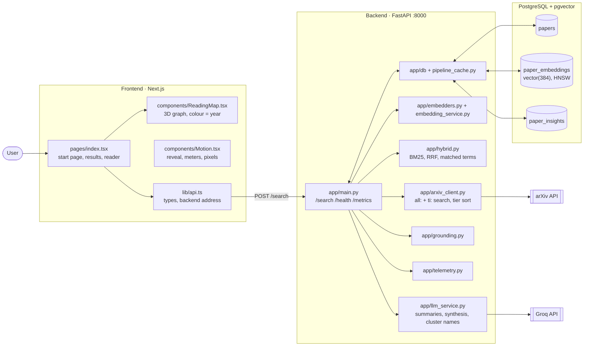
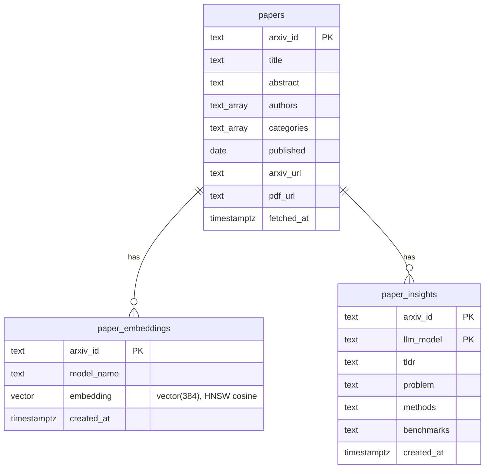

# Project Report — Kavosh (BTP Semester 7)

*Kavosh (کاوش) is Persian for "exploration". The project was called Research
Copilot until November 2026.*

## 1. Overview

Kavosh helps students and researchers get into a topic quickly. Given a topic,
it retrieves candidate papers from arXiv, ranks them by meaning with a sentence
embedding model, summarises each one with an LLM (TL;DR, problem, method,
benchmarks) and checks the summary against the abstract, writes a cross-paper
synthesis, and draws a 3D reading map of how the papers relate.

| Layer | Technology |
|---|---|
| Backend | FastAPI (Python 3.12) |
| Embeddings | sentence-transformers, `all-MiniLM-L6-v2` on CPU by default; swappable |
| LLM | Groq API, `openai/gpt-oss-20b` |
| Storage | PostgreSQL 16 + pgvector (HNSW cosine index), SQLAlchemy 2, Alembic |
| Frontend | Next.js 16 (pages router), React, Tailwind CSS v4, react-force-graph-3d / three.js |
| Evaluation | `eval/` harness (noise robustness benchmark, threshold calibration, t-SNE) |
| Deployment | Frontend on Vercel; backend on the developer's machine, shared through a Cloudflare quick tunnel; `docker-compose.yml` for a one-command backend |

The project is also the Semester 7 continuation of the Semester 6 study on word
embeddings under textual noise (Section 8 and `docs/SEM6_CONTINUITY.md`).

## 2. Architecture



The backend is organised as small modules (arXiv client, embedders, hybrid
retrieval, LLM service, grounding, telemetry, database layer) orchestrated by
the `search()` handler in `main.py`. All tunable values live in `config.py` and
are read from the environment.

## 3. Search pipeline

`POST /search` with `{topic, max_results}` (default 5) runs these steps:

1. **Embed the topic** with the active embedder.
2. **Cache-first lookup.** Query `paper_embeddings` by cosine similarity with a
   12-hour freshness window (Postgres chooses an exact scan or the HNSW index;
   the HNSW scan is told to keep searching until the filter yields enough rows). For short topics (≤ 2 words), if the best
   hit reaches `CACHE_TOP_SCORE` and at least `max_results` hits reach
   `CACHE_STRONG_SCORE`, the stored papers are used and arXiv is skipped.
3. **Otherwise fetch from arXiv** (`arxiv_client.search_papers`): up to 50
   candidates from an `all:` query; a `ti:` title query for up to 10 more runs
   only when fewer than 3 of those titles contain every significant query word.
   Versions of one paper are merged (newest kept) and the list is tier-sorted
   (exact title first, then titles containing every significant word). User
   text is escaped so it cannot change the query. Requests are paced, cached
   per topic and backed off after a 429; if arXiv is unavailable, the closest
   stored papers are returned (`cache_path: "stale"`) or the API answers 503.
4. **Rank** by cosine similarity, reusing stored vectors and embedding only new
   abstracts. With `HYBRID_RETRIEVAL=1` (the default), BM25 over title +
   abstract is fused with the dense ranking by Reciprocal Rank Fusion
   (`k = 60`); the fused order decides which papers make the top results.
5. **Rescale scores** for display: `sigmoid(10 · (cosine − β))`, with β
   different for short and long queries, plus a `TITLE_BOOST` (+0.15) when the
   topic appears in the title; a near-exact title match is pinned to 1.0. The
   top results are then sorted by this score, so the displayed order is the
   rescaled dense score, not the RRF order.
6. **Summaries.** Stored summaries are read first; missing ones are requested
   from Groq 8 papers per call and parsed defensively (`_safe_json_loads` keeps
   valid escapes and repairs raw LaTeX; items are aligned by position, or by
   declared index only when unambiguous). Summaries with no content ("Error" or
   all "N/A") are never stored, and stored ones are treated as missing.
7. **Grounding check** (`grounding.py`): the share of summary terms found in
   the abstract, and the terms that were not (no score when there is nothing
   to check).
8. **Synthesis**: one Groq call combining the summaries.
9. **Reading map**: up to 30 papers. Link weight = 0.65 × abstract similarity
   + 0.25 × category overlap (Jaccard) + 0.10 × shared author; links above a
   threshold are kept. Node size is the number of links. Clusters are connected
   components, named by one Groq call.
10. **Cache write-back** of papers, embeddings and summaries, and telemetry.


## 4. API

| Endpoint | Purpose |
|---|---|
| `POST /search` | Run the pipeline. Body: `topic` (1–500 chars, not blank), `max_results` (integer 1–50, default 5). Errors: 404 no papers, 422 invalid body, 429 rate limit, 503 arXiv unavailable (429/503 carry `Retry-After`). |
| `GET /health` (also `HEAD`) | Status, database status, the active embedding model, LLM and hybrid setting. |
| `GET /metrics` | Uptime, counters, cache hit rates, and p50/p95/mean latency per pipeline stage and cache path. This machine only. |
| `GET /docs` | Interactive API documentation generated by FastAPI. This machine only (`EXPOSE_DOCS=1` to serve it through the tunnel). |

Response of `/search`:

| Field | Contents |
|---|---|
| `papers[]` | `title`, `abstract`, `authors`, `arxiv_id`, `arxiv_url`, `pdf_url`, `published`, `categories`, `relevance_score`, `summary` (`tldr`, `problem`, `methods`, `benchmarks`, `grounding`), `matched_terms` |
| `synthesis` | Cross-paper synthesis text |
| `graph.nodes[]` | `id`, `title`, `val`, `cluster`, `year`, `short_label` (e.g. "Ye 2024"), `primary_category`, `degree`, `author_surnames`, `arxiv_url`, `pdf_url` |
| `graph.links[]` | `source`, `target`, `weight` |
| `meta` | `cache_path` (`warm` = cache-first hit, `cold` = fetched from arXiv, `stale` = arXiv unavailable, stored papers shown), `latency_seconds`, `embed_model`, `hybrid_retrieval` |

A topic with no arXiv matches returns 404 ("No papers matched ..."), which the
frontend shows as an empty result rather than an error. Other errors are shown
as plain messages; the frontend never displays raw response bodies.

## 5. Data layer



- **papers:** one row per arXiv ID, as returned by arXiv including the
  version (`2605.12335v2`, or `hep-th/9804003v2` for old-style IDs).
- **paper_embeddings:** a 384-dimensional vector per paper with an HNSW cosine
  index. The primary key is `arxiv_id` alone, so only one embedding model's
  vector is kept per paper; reads filter on `model_name` so vectors from
  different models are never mixed.
- **paper_insights:** LLM summaries keyed by `(arxiv_id, llm_model)`.
- Writes are upserts (`ON CONFLICT`); the schema is created by Alembic
  migration `0001_initial.py`.

## 6. Frontend

- **Start page** (`pages/index.tsx`): a live status bar from `/health`, a
  headline revealed word by word, a search field with example topics, a
  "what happens when you search" section whose lines darken as they scroll
  into view, and a wordmark footer.
- **Results:** three panes on wide screens (ranked list | reader | map),
  stacking below 1024 px. Ranked rows show rank, title with matched terms
  highlighted, author · year · category, and relevance as a segmented meter.
  The reader has a Synthesis tab (with the papers it draws from) and a Paper
  tab (TL;DR, problem, method, benchmarks, summary check, abstract, arXiv and
  PDF links).
- **Loading and errors:** the request starts at once; a five-step checklist
  with a block progress bar advances on a timer alongside it (an indication,
  not live progress). Empty and error states use plain language; a search can
  be replaced by a new one and times out after 120 s. Stale answers carry a
  "Stored copy" badge.
- **Reading map** (`components/ReadingMap.tsx`): 3D force graph. Colour is
  publication year on a single-hue ramp; size is link count; ranked results
  carry a ring; selecting a paper highlights its neighbours and dims the rest.
  Hovering a node shows a card with arXiv page and PDF buttons; the details
  panel lists the most similar papers; clusters can be filtered. The layout is
  computed before the first frame, so the graph does not animate, and the
  camera is framed from the laid-out positions.
- **Design:** tokens in `styles/globals.css` (ice-blue / navy palette, light and
  dark themes; resting text is at least 4.5:1 contrast, and the pale "ghost"
  colour appears only briefly while words animate in), Geist and Geist Mono via
  `next/font`, motion primitives in `components/Motion.tsx` that respect
  `prefers-reduced-motion`. The design rules are recorded in
  `docs/DESIGN.md`.
- **Backend address** (`lib/api.ts`): a `?api=` link to a bare tunnel or local
  origin (remembered for 24 hours, dropped when it stops answering, resettable
  from the status bar), else `NEXT_PUBLIC_API_BASE`, else
  `http://localhost:8000`.

## 7. Configuration

Environment variables (see `.env.example`; defaults in `backend/app/config.py`):

| Variable | Default | Purpose |
|---|---|---|
| `GROQ_API_KEY` | — (required) | Groq authentication |
| `GROQ_MODEL` | `openai/gpt-oss-20b` | LLM for summaries, synthesis, cluster names |
| `DATABASE_URL` | `research` on localhost as the original developer's user | Postgres connection; set it in `backend/.env` |
| `EMBED_MODEL` | `all-MiniLM-L6-v2` | Must be 384-d for the live server (also `BAAI/bge-small-en-v1.5`, `hash-ngram:384`) |
| `HYBRID_RETRIEVAL` | `1` | BM25 + dense fusion |
| `ARXIV_CANDIDATES` | `50` | Candidates fetched per search |
| `ARXIV_MIN_INTERVAL` | `3` | Seconds between any two arXiv requests |
| `ARXIV_CACHE_TTL_HOURS` | `6` | How long a topic's arXiv results are reused |
| `ARXIV_COOLDOWN_SECONDS` | `60` | Pause on arXiv after an HTTP 429 |
| `SEARCH_RATE_LIMIT_PER_MIN` | `10` | Searches per visitor per minute (`0` = off) |
| `SEARCH_GLOBAL_LIMIT_PER_MIN` | `30` | Searches per minute from all visitors together (`0` = off) |
| `ARXIV_HTTP_TIMEOUT` / `ARXIV_LOCK_WAIT` | `20` / `45` | Seconds per arXiv request / longest wait for the shared arXiv slot |
| `INSIGHT_BATCH_SIZE` | `8` | Papers per LLM summary call |
| `CORS_ORIGINS` / `CORS_ORIGIN_REGEX` | localhost:3000, the Vercel site and its previews | Allowed browser origins |
| `EXPOSE_DOCS` | `0` | Serve `/docs`, `/openapi.json` and `/metrics` to tunnel visitors too |
| `CACHE_TTL_HOURS` | `12` | Freshness window for the cache-first lookup |
| `CACHE_TOP_SCORE` / `CACHE_STRONG_SCORE` | `0.40` / `0.35` | Cache thresholds (measured values: 0.46 / 0.41, Section 8; not the shipped defaults) |
| `CALIB_BETA_SHORT` / `CALIB_BETA_LONG` | `0.30` / `0.35` | Display rescaling offsets (measured: 0.19 / 0.40; not the shipped defaults) |
| `TITLE_BOOST` | `0.15` | Score boost when the topic appears in the title |
| `GRAPH_MAX_NODES` | `30` | Papers in the reading map |
| `NEXT_PUBLIC_API_BASE` (frontend) | `http://localhost:8000` | Backend address for a deployed frontend |

## 8. Evaluation and results

### 8.1 Continuity with Semester 6

Semester 6 compared word embeddings for sentiment classification under textual
noise and found that the encoder best on clean text (BERT) degraded most under
heavy out-of-vocabulary noise, where subword models (FastText) held up. Semester
7 deploys a BERT-family encoder (MiniLM) on short, noisy search queries, so the
research question is:

> Does the clean-accuracy versus robustness trade-off measured for
> classification in Sem 6 also hold for retrieval, and does hybrid retrieval
> remove it?

The Sem 6 noise types and intensities are reused unchanged (`eval/noise.py`):
character noise, word dropout and out-of-vocabulary injection at 5–50%.

### 8.2 Method

- **Corpus** (`eval/build_dataset.py`): 816 recent arXiv papers from cs.CL,
  cs.LG, cs.CV, cs.IR, cs.RO and stat.ML.
- **Task:** known-item retrieval. Each paper's title is the query and its
  abstract is the only relevant document, so no manual labelling is needed.
- **Metrics** (`eval/ir_metrics.py`): Recall@1, Recall@10, MRR, nDCG@10, with
  95% intervals over 5 noise seeds. The intervals use a normal approximation
  (1.96 · sd / √5); with 5 seeds a t-interval would be about 1.4× wider, and
  they reflect noise variation only, not query sampling.
- **Systems** (`eval/systems.py`): MiniLM, bge-small, a hashed character n-gram
  embedder, BM25, and BM25 + MiniLM fused with RRF.

### 8.3 Results

Full nDCG@10 tables and plots are in `eval/results/` (`summary.md`, CSV, JSON).

**Answer to the research question.**

1. Among the systems tested, BM25 leads in nDCG@10 on clean queries and under
   every noise type (the hybrid has a slightly higher Recall@10 in most
   conditions). This does not show that the Sem 6 crossover is absent: the
   only subword system is a hashed embedder with no learned semantics (0.301
   clean), not a real subword model such as FastText.
2. In absolute nDCG@10 the WordPiece encoders lose the most under
   out-of-vocabulary noise (MiniLM −0.426, bge −0.354 at 50%), as BERT did. In
   relative terms the hashed embedder loses even more (about 48%), so "subword
   systems lose least" does not hold for this baseline. For BM25 the injected
   tokens are simply unknown words, so OOV noise acts like word dropout.
3. Hybrid retrieval reduces the gap but does not remove it: it lifts MiniLM's
   50% OOV score from 0.524 to 0.742 (loss 0.237 instead of 0.426) and scores
   0.028 above MiniLM on clean queries, but stays below BM25 (0.979 vs 0.983
   clean, 0.742 vs 0.843 at 50% OOV).

### 8.4 Cache thresholds and embedding space

- **Cache thresholds** (`eval/calibrate_thresholds.py`): because the cache only
  serves short queries, thresholds were measured on two-word queries by
  replaying the cache rule. `CACHE_TOP_SCORE = 0.46` and
  `CACHE_STRONG_SCORE = 0.41` serve 8.2% of short queries from cache with 72%
  of served hits on-topic (on-topic = shares an arXiv category; base rate 35%).
  These figures count each query's own paper as a hit and were measured on the
  same queries used to choose the thresholds, so they are optimistic; they
  need re-measuring with the query's own paper excluded and a held-out split.
  The measured values are used only in the developer's `backend/.env`; the
  shipped defaults remain 0.40 / 0.35.
- **Embedding map** (`eval/embedding_map.py`): t-SNE of abstract embeddings.
  Silhouette (cosine) over the six categories: bge-small 0.049, MiniLM 0.046,
  hash-ngram −0.031. cs.CV, cs.RO and cs.IR form clear clusters; cs.LG and
  stat.ML overlap heavily.

### 8.5 Related work and design justification

**Lexical and dense retrieval.** BM25 [2] scores documents by exact term
overlap, weighted by term rarity and document length. It is cheap and a strong
zero-shot baseline: the BEIR benchmark describes it as "a robust baseline" and
reports that dense and sparse neural retrievers often generalise worse than
other approaches [3]. Dense encoders such as MiniLM match by meaning, so they
can find a paper that never uses the query's words, but a rare term is only one
of many tokens averaged into a single vector.

**Hybrid retrieval.** Blended RAG [4] combines semantic and keyword queries and
reports NDCG@10 of 0.87 on TREC-COVID against 0.804 for COCO-DR Large (+8.2%),
and 0.67 on Natural Questions against 0.633 for monoT5-3B (+5.8%). These are
the authors' own results on their setup, not a guarantee for other corpora.

**Rank fusion.** BM25 scores are unbounded while cosine similarity lies in
[−1, 1], so a weighted sum of raw scores needs normalisation to be meaningful.
Reciprocal Rank Fusion (RRF) [1] uses only rank positions, so no normalisation
is needed. It scores a document by the sum of 1 / (k + rank) over the rankings
being fused. Cormack et al. fixed k = 60 in a pilot and found it near-optimal
on their TREC experiments; that setting was tuned for those collections, not
for a pool of about 50 candidates like ours.

**What this project measures.** Kavosh fuses BM25 and MiniLM with RRF
(`HYBRID_RETRIEVAL`, on by default; `k = 60`) to choose the top results, which
are then shown in order of their rescaled dense score. The benchmark's hybrid
system ranks by the RRF score alone, so it measures the fusion, not this final
re-sort. The benchmark in 8.3 does not
show an advantage for the hybrid: its queries are paper titles scored against
their own abstracts, which share most of their words, and BM25 is best in every
column. The hybrid does beat MiniLM alone, most under out-of-vocabulary noise
(nDCG@10 0.742 against 0.524 at 50%, a loss of 0.237 against 0.426), but it
still loses more than BM25 alone (0.140). Note that BM25 ignores the injected
tokens, so that noise type behaves like word dropout for it. Whether the hybrid
helps on short, vague or paraphrased topic queries is not tested here. The
fusion constant `k` and a `hybrid:bge-small-en-v1.5` variant are also untested,
and are the natural next experiments.

**References**

1. G. V. Cormack, C. L. A. Clarke and S. Büttcher, "Reciprocal rank fusion
   outperforms Condorcet and individual rank learning methods," in *Proc. 32nd
   Int. ACM SIGIR Conf. Research and Development in Information Retrieval*,
   2009, pp. 758–759, doi: 10.1145/1571941.1572114.
2. S. Robertson and H. Zaragoza, "The probabilistic relevance framework: BM25
   and beyond," *Foundations and Trends in Information Retrieval*, 2009,
   doi: 10.1561/1500000019.
3. N. Thakur, N. Reimers, A. Rücklé, A. Srivastava and I. Gurevych, "BEIR: A
   heterogeneous benchmark for zero-shot evaluation of information retrieval
   models," in *Proc. NeurIPS Datasets and Benchmarks Track*, 2021,
   arXiv:2104.08663.
4. K. Sawarkar, A. Mangal and S. R. Solanki, "Blended RAG: Improving RAG
   (retriever-augmented generation) accuracy with semantic search and hybrid
   query-based retrievers," in *Proc. IEEE 7th Int. Conf. Multimedia Information
   Processing and Retrieval (MIPR)*, 2024, arXiv:2404.07220.

## 9. Testing

- **`tests/`** (pytest, no network, database or API key needed; arXiv, Groq
  and Postgres are stubbed):
  - `test_api.py`: the real `/search` pipeline end to end (title pin,
    grounding, graph, scores sorted), the hybrid flag, `/metrics` and
    `/health`, arXiv query escaping, private pages, strict input types, CORS,
    and the documented error responses.
  - `test_arxiv_resilience.py`: arXiv pacing, cooldown after 429, the topic
    cache (keys and copies), title-query skipping, version merging, old-style
    IDs, timeouts, the per-visitor and global rate limits, and 503/429
    responses.
  - `test_llm_output.py`: JSON repair (LaTeX and real escapes), alignment of
    summaries to papers, chunked summary calls, truncated replies, synthesis
    fallbacks.
  - `test_insight_cache.py`: failed summaries are not stored and get no
    grounding score.
  - `test_retrieval.py`: embedders, registry caching, BM25, RRF, matched terms,
    grounding, and the benchmark end to end on a toy corpus.
  - `test_ir_metrics.py`, `test_noise.py`: metrics, intervals, and the noise
    functions.
- **`qa/regression_v2.py`:** live regression against a running server:
  validation, CORS, functional invariants on the graph, and concurrent load.
- **Frontend:** `npx tsc --noEmit` and `npm run build`.

## 10. Running and deployment

- **Local:** `./dev.sh` starts the backend (uvicorn with auto-reload on
  127.0.0.1:8000) and the frontend (Next.js dev server on :3000). See README
  for setup. `/docs` and `/metrics` answer only requests made on this machine.
- **Database cleanup:** `backend/scripts/cleanup_2026_11.sql` re-keys
  old-style arXiv IDs, removes older paper versions and removes summaries with
  no content. Take a `pg_dump` backup first.
- **Docker:** `docker-compose.yml` starts Postgres + pgvector and the API
  (published on 127.0.0.1:8000 only); the backend image installs CPU-only
  PyTorch and runs `alembic upgrade head` on start.
- **Deployed demo:** the frontend is deployed on Vercel from `main`
  (https://btp-sem-07.vercel.app). `./tunnel.sh` exposes the local backend
  through a Cloudflare quick tunnel and prints a share link with `?api=`.
- **Git workflow:** work happens on `sem6-continuity-eval`. Earlier changes
  reached `main` through pull requests; recent fixes were fast-forwarded to
  `main` directly.

## 11. Known issues and limitations

| Issue | Effect | Status / fix |
|---|---|---|
| Display order vs hybrid | RRF picks the top results, but they are shown in rescaled dense-score order | Open: decide whether to show the RRF order or keep the dense order |
| Warm cache rarely used | Only topics of ≤ 2 words that pass both thresholds are served from the cache | Open: revisit the cache rule (e.g. exact-topic reuse) |
| Clustering | Connected components tend to give one large cluster plus singletons | Open: try community detection or a stricter link threshold |
| Tunnel access | `/search` has no authentication; anyone with the link can search | Partly fixed: per-visitor (10/min) and global (30/min) limits, private `/docs` and `/metrics`; a key would be needed for wider sharing |
| Demo depends on a laptop | The deployed site can search only while `./dev.sh` and `./tunnel.sh` run | Host the backend (Docker image is ready) and set `NEXT_PUBLIC_API_BASE` |
| One vector per paper | Switching `EMBED_MODEL` overwrites stored vectors | Primary key `(arxiv_id, model_name)` with a migration |
| No CI | Tests run only by hand | GitHub Actions for pytest and the frontend build |
| Evaluation task | Title→abstract favours lexical matching; the only subword baseline is weak (Section 8.3) | Add topic or paraphrase queries and a real subword baseline |
| Live server dimension | pgvector column is fixed at 384-d | Parameterise the migration |

Fixed since the first version of this report: score order after the title
boost, arXiv 429 handling (pacing, cooldown, cache, stale fallback), failed
summaries no longer cached, JSON parsing of LaTeX, summary-to-paper alignment,
the arXiv cache key, old-style arXiv IDs and duplicate versions (in code;
existing rows are fixed by the cleanup script), filtered HNSW
search, proxy-header trust in the rate limiter, and CORS limited to this
project's origins.

## 12. Repository layout

```
BTP_SEM_07/
├── backend/
│   ├── app/            main.py, config.py, arxiv_client.py, embedders.py,
│   │                   embedding_service.py, hybrid.py, llm_service.py,
│   │                   grounding.py, telemetry.py, ratelimit.py,
│   │                   pipeline_cache.py, db/
│   ├── alembic/        migrations (0001_initial.py)
│   ├── scripts/        one-off database cleanup SQL
│   ├── Dockerfile
│   └── requirements.txt
├── frontend/
│   ├── pages/          _app.tsx (fonts), _document.tsx (lang), index.tsx (all views)
│   ├── components/     ReadingMap.tsx, Motion.tsx
│   ├── lib/api.ts      types and backend address
│   └── styles/         globals.css (design tokens)
├── eval/               dataset, noise, metrics, systems, benchmark,
│                       calibration, embedding map; results/ committed
├── tests/              pytest suite
├── qa/                 live regression script
├── docs/               SEM6_CONTINUITY.md, DESIGN.md
├── specs/              earlier design notes
├── docker-compose.yml, dev.sh, tunnel.sh, .env.example
└── README.md, REPORT.md
```
